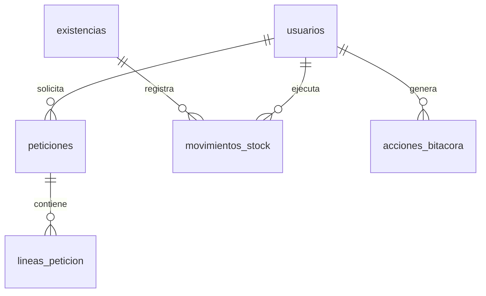
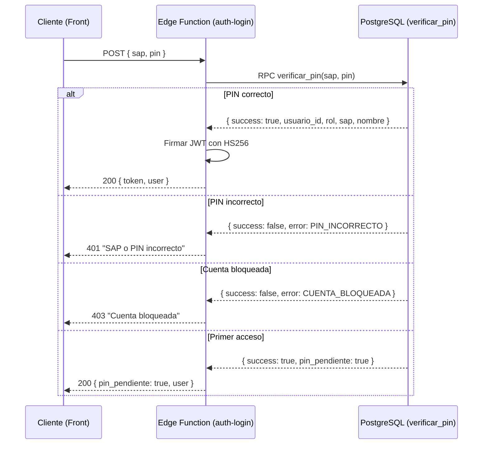
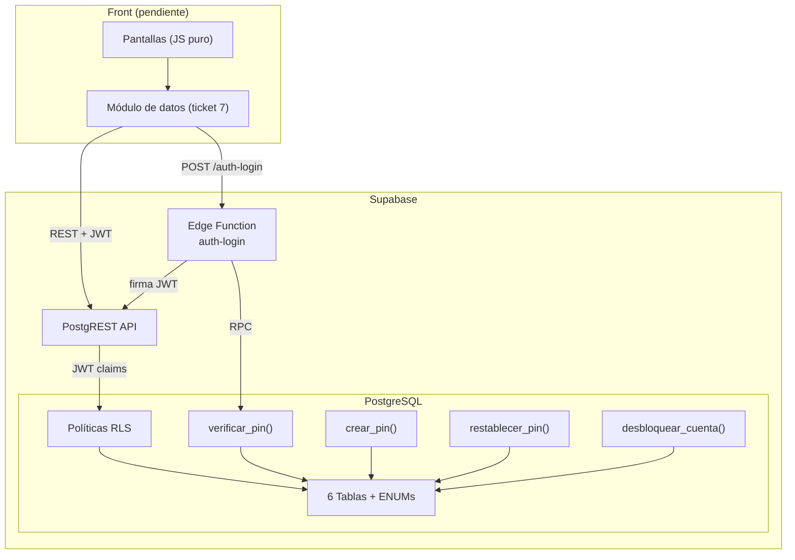

# Análisis Completo: Tickets 1 a 6 — Uniformes FOJ

> Este documento explica **qué se construyó, por qué y cómo** en cada ticket. Está diseñado para que puedas revisar cada decisión y defenderla en una entrevista técnica.

---

## Mapa de archivos tocados

| Ticket | Archivo | Propósito |
|--------|---------|-----------|
| 1 | [`20261016164511_init.sql`](file:///Users/carlosnares/Proyectos_personales/Uniformes_FOJ/Uniformes_FOJ/supabase/migrations/20261016164511_init.sql) | Esquema base completo |
| 2 | [`20261016170759_catalogo_prendas.sql`](file:///Users/carlosnares/Proyectos_personales/Uniformes_FOJ/Uniformes_FOJ/supabase/migrations/20261016170759_catalogo_prendas.sql) | 100 combinaciones + validador |
| 3 | [`seed.sql`](file:///Users/carlosnares/Proyectos_personales/Uniformes_FOJ/Uniformes_FOJ/supabase/seed.sql) | Datos ficticios de desarrollo |
| 4 | [`20261016180028_auth_sap_pin.sql`](file:///Users/carlosnares/Proyectos_personales/Uniformes_FOJ/Uniformes_FOJ/supabase/migrations/20261016180028_auth_sap_pin.sql) + [`auth-login/index.ts`](file:///Users/carlosnares/Proyectos_personales/Uniformes_FOJ/Uniformes_FOJ/supabase/functions/auth-login/index.ts) | Autenticación SAP+PIN y JWT |
| 5 | [`20261016182109_admin_gestion_pin.sql`](file:///Users/carlosnares/Proyectos_personales/Uniformes_FOJ/Uniformes_FOJ/supabase/migrations/20261016182109_admin_gestion_pin.sql) | Bloqueo, restablecimiento, desbloqueo |
| 6 | [`20261016183303_rls_politicas_seguridad.sql`](file:///Users/carlosnares/Proyectos_personales/Uniformes_FOJ/Uniformes_FOJ/supabase/migrations/20261016183303_rls_politicas_seguridad.sql) | Row Level Security por rol |

---

## Ticket 1 — Migraciones base (esquema completo)

### Qué se hizo
Se creó la primera migración SQL ([`init.sql`](file:///Users/carlosnares/Proyectos_personales/Uniformes_FOJ/Uniformes_FOJ/supabase/migrations/20261016164511_init.sql)) que define **todo el esquema relacional** del sistema: 6 tablas, 4 tipos `ENUM` y 5 índices.

### Estructura creada



### Tablas y su propósito

| Tabla | Para qué sirve | Columnas clave |
|-------|----------------|----------------|
| `usuarios` | Identidad y credenciales de acceso | `sap` (único), `rol` (enum), `pin_hash`, `bloqueado`, `pin_pendiente` |
| `peticiones` | Ciclo de vida de cada solicitud de uniforme | `estado` (enum: 5 estados), `motivo`, ventanas propuesta/confirmada, `motivo_rechazo` |
| `lineas_peticion` | Prendas individuales dentro de una petición | `prenda_tipo`, `prenda_color`, `prenda_talla`, `devuelta` |
| `existencias` | Inventario actual por combinación tipo/color/talla | `cantidad` (con `CHECK >= 0`), constraint `UNIQUE` compuesto |
| `movimientos_stock` | Trazabilidad de cada entrada/salida de inventario | `tipo_movimiento`, `cantidad`, FK a `existencia_id` y `peticion_id` |
| `acciones_bitacora` | Auditoría general de toda acción en el sistema | `tipo_accion`, `entidad`, `detalle` (JSONB) |

### Decisiones técnicas clave

**1. UUID como primary key** en todas las tablas:
- No se usa `SERIAL`/`BIGSERIAL`. Los UUID permiten generar IDs desde la BD sin colisiones, crucial para un sistema que podría escalar o migrar.
- Se usa `gen_random_uuid()` (función nativa de PostgreSQL 13+), sin dependencia extra.

**2. ENUMs como tipos de PostgreSQL** (no strings libres):
```sql
CREATE TYPE estado_peticion AS ENUM ('pendiente', 'aprobada', 'rechazada', 'en_proceso', 'entregada');
```
- **Por qué:** PostgreSQL valida a nivel de motor. Si alguien intenta insertar un estado `'cancelada'` que no existe, la BD lo rechaza antes de que llegue a la aplicación. Es más seguro que un `CHECK` con strings.
- **Tradeoff:** Cambiar un ENUM requiere migración (`ALTER TYPE ... ADD VALUE`), pero en este proyecto los estados son inmutables por diseño (AGENTS.md: "No agregues estados").

**3. `NULLS NOT DISTINCT` en el constraint único de `existencias`:**
```sql
CONSTRAINT uq_existencias_combinacion UNIQUE NULLS NOT DISTINCT (prenda_tipo, prenda_color, prenda_talla)
```
- **El problema:** Las botas no tienen color (`NULL`). En SQL estándar, `NULL ≠ NULL`, así que `UNIQUE(botas, NULL, '27')` y `UNIQUE(botas, NULL, '27')` se tratarían como diferentes → duplicados silenciosos.
- **La solución:** `NULLS NOT DISTINCT` (PostgreSQL 15+) trata dos NULLs como iguales dentro del constraint. Esto garantiza exactamente una fila por combinación.

**4. `CHECK (cantidad >= 0)` en `existencias`:**
- Última línea de defensa. Aunque la lógica de negocio nunca debería dejar el stock negativo, si un bug lo intentara, PostgreSQL aborta la transacción. Regla del brief: "nunca debe quedar negativo".

**5. `ON DELETE RESTRICT` en FKs críticas:**
- No se puede borrar un usuario que tenga peticiones ni un movimiento de stock huérfano. `ON DELETE CASCADE` solo se usa en `lineas_peticion → peticiones` (si borras la petición, sus líneas no tienen sentido solas).

**6. Índices para consultas frecuentes:**
```sql
CREATE INDEX idx_peticiones_usuario_id ON peticiones(usuario_id);
CREATE INDEX idx_peticiones_estado ON peticiones(estado);
```
- El colaborador siempre filtra por `usuario_id` (mis peticiones). Admin filtra por `estado` (pendientes). Sin índice, PostgreSQL haría table scan en cada consulta.

> [!IMPORTANT]
> RLS **no** se habilita aquí. Primero se necesita el mecanismo de autenticación (ticket 4) para que haya un JWT del cual extraer el rol. Habilitarlo antes rompería las inserciones del seed.

---

## Ticket 2 — Catálogo de prendas, colores y tallas

### Qué se hizo
Se creó la migración [`catalogo_prendas.sql`](file:///Users/carlosnares/Proyectos_personales/Uniformes_FOJ/Uniformes_FOJ/supabase/migrations/20261016170759_catalogo_prendas.sql) que:
1. Define la función `es_combinacion_valida()` como validador del dominio.
2. Carga las **100 combinaciones oficiales** en `existencias` con `cantidad = 0`.

### Las 100 combinaciones del catálogo

| Prenda | Colores | Tallas | Combinaciones |
|--------|---------|--------|---------------|
| Escafandra | rojo, verde, rosa, azul, morado, gris | única | **6** |
| Pantalón | rojo, verde, rosa, azul, morado, gris | S, M, L, XL, XXL, XXXL, 4XL | **42** |
| Playera | rojo, verde, rosa, azul, morado, gris | S, M, L, XL, XXL, XXXL, 4XL | **42** |
| Botas | (sin color) | 22, 23, 24, 25, 26, 27, 28, 29, 30, 31 | **10** |
| | | **Total** | **100** |

### La función `es_combinacion_valida()`

```sql
CREATE OR REPLACE FUNCTION es_combinacion_valida(
    p_tipo tipo_prenda, p_color TEXT, p_talla TEXT
) RETURNS BOOLEAN AS $$
```

**Qué valida:**
- Escafandra → acepta solo los 6 colores + talla `'unica'`. Si alguien manda `talla = 'M'`, devuelve `FALSE`.
- Pantalón/Playera → acepta los 6 colores + las 7 tallas de ropa.
- Botas → color **debe ser NULL** + talla debe ser `'22'` a `'31'`.

**¿Por qué es `IMMUTABLE`?**
- La función no consulta tablas ni depende de estado mutable; solo compara los parámetros contra arrays fijos. PostgreSQL puede cachear el resultado y usarlo en índices funcionales.
- Esto importa cuando se va a llamar desde `crear_peticion()` (ticket 8) para cada línea de la petición: la BD sabe que no cambiará entre llamadas.

### Técnica de inserción masiva con `unnest` + `CROSS JOIN`

```sql
-- Pantalones: 6 colores × 7 tallas = 42 filas
INSERT INTO existencias (prenda_tipo, prenda_color, prenda_talla, cantidad)
SELECT 'pantalon'::tipo_prenda, color, talla, 0
FROM unnest(ARRAY['rojo', 'verde', ...]) AS color
CROSS JOIN unnest(ARRAY['S', 'M', 'L', ...]) AS talla
ON CONFLICT (...) DO NOTHING;
```

- `unnest` convierte un array en filas.
- `CROSS JOIN` hace el producto cartesiano (cada color × cada talla).
- `ON CONFLICT DO NOTHING` hace la migración idempotente: si la corres dos veces, no falla ni duplica.

---

## Ticket 3 — Datos de ejemplo (seed)

### Qué se hizo
Se creó [`seed.sql`](file:///Users/carlosnares/Proyectos_personales/Uniformes_FOJ/Uniformes_FOJ/supabase/seed.sql) con datos 100% ficticios para desarrollo y pruebas.

### Usuarios de ejemplo

| Rol | SAP | Nombre | PIN | Estado |
|-----|-----|--------|-----|--------|
| Colaborador | `10000001` | Juan Pérez Demo | `1234` | Activo |
| Colaborador | `10000002` | María Gómez Demo | `5678` | Activo |
| Colaborador | `10000003` | Pedro López Demo | — | PIN pendiente (1er acceso) |
| Administrador | `90000001` | Carlos Admin Demo | `9999` | Activo |
| RH | `80000001` | Ana RH Demo | `8888` | Activo |

### Peticiones en cada estado

| Estado | Quién | Motivo | Detalle notable |
|--------|-------|--------|-----------------|
| `pendiente` | Juan | suciedad | Pantalón azul M + playera azul M |
| `aprobada` | María | daño | Escafandra roja, ventana confirmada por RH |
| `rechazada` | Juan | otro | Botas 27, con motivo de rechazo obligatorio |
| `en_proceso` | María | suciedad | Pantalón gris L + playera gris L |
| `entregada` (con devolución) | Juan | daño | Playera azul M, `devuelta = TRUE`, recepción confirmada |
| `entregada` (sin devolución) | María | desgaste | Botas 26, `sin_devolucion = TRUE` → alerta visible |

### Decisiones técnicas

**1. UUIDs predecibles (`a0000000-...`):**
- Se usan IDs fijos para poder referenciar usuarios en las peticiones sin hacer `SELECT` previo. Esto simplifica el seed y lo hace legible.

**2. PINs hasheados con la misma función del sistema:**
```sql
crypt('1234', gen_salt('bf'))
```
- Los PINs en el seed usan **exactamente el mismo hash Blowfish** que la función `crear_pin()`. No se guardan en texto plano ni siquiera en los datos de ejemplo.

**3. Idempotencia:**
- Usuarios: `ON CONFLICT (sap) DO UPDATE SET ...` → si el seed corre dos veces, sobrescribe limpiamente.
- Peticiones y líneas: `ON CONFLICT (id) DO NOTHING` → no duplica.
- Stock: el bloque `DO $$` con `WHERE NOT EXISTS` previene movimientos duplicados.

**4. Stock con trazabilidad desde el día 0:**
```sql
FOR r IN SELECT id, cantidad FROM existencias WHERE cantidad > 0
LOOP
    INSERT INTO movimientos_stock (...) SELECT ... WHERE NOT EXISTS (...);
END LOOP;
```
- Cada fila de stock > 0 tiene su movimiento de entrada correspondiente en `movimientos_stock`, registrado por `Ana RH Demo`. Así no hay stock "mágico" sin origen.

**5. Se ejecuta con `supabase db reset`:**
- Este comando destruye la BD, corre todas las migraciones en orden y luego ejecuta `seed.sql`. El resultado es siempre un entorno limpio e idéntico.

---

## Ticket 4 — Auth SAP + PIN (autenticación propia)

### Qué se hizo
Se construyó un sistema de autenticación completo en **dos capas**:
1. **Capa SQL** ([`auth_sap_pin.sql`](file:///Users/carlosnares/Proyectos_personales/Uniformes_FOJ/Uniformes_FOJ/supabase/migrations/20261016180028_auth_sap_pin.sql)): funciones `verificar_pin()` y `crear_pin()`.
2. **Capa serverless** ([`auth-login/index.ts`](file:///Users/carlosnares/Proyectos_personales/Uniformes_FOJ/Uniformes_FOJ/supabase/functions/auth-login/index.ts)): Edge Function que orquesta la verificación y emite el JWT.

### Arquitectura de autenticación



### ¿Por qué no usar Supabase Auth?

Supabase Auth usa email + contraseña o proveedores OAuth. En la planta de Nestlé, los colaboradores se identifican por **número SAP** (no tienen email corporativo de uso diario) y usan un **PIN de 4 dígitos** (no una contraseña). Forzar Supabase Auth significaría:
- Inventar emails falsos como `10000001@uniformes.local` → hackeo del modelo.
- Perder el control sobre el flujo de primer acceso (crear PIN).
- No poder implementar bloqueo a 3 intentos con la lógica de negocio del brief.

**La decisión fue: tabla `usuarios` propia + funciones PL/pgSQL + Edge Function para JWT.**

### Función `verificar_pin()` — Capa SQL

```sql
FUNCTION verificar_pin(p_sap TEXT, p_pin TEXT) RETURNS JSONB
```

**Flujo interno:**
1. Busca usuario por SAP → si no existe, devuelve `success: false` (mensaje genérico).
2. Si `bloqueado = true` → devuelve `CUENTA_BLOQUEADA`.
3. Si `pin_pendiente = true` → devuelve datos del usuario con `pin_pendiente: true` (sin verificar PIN).
4. Compara hash: `pin_hash = crypt(p_pin, pin_hash)`.
   - Correcto → resetea `intentos_fallidos = 0`, devuelve datos del usuario.
   - Incorrecto → incrementa intentos, si llega a 3 bloquea y registra en bitácora.

**¿Por qué devuelve JSONB en vez de lanzar `RAISE EXCEPTION`?**
> [!IMPORTANT]
> Un `RAISE EXCEPTION` hace **rollback** de toda la transacción. Si el PIN es incorrecto y lanzamos excepción, el `UPDATE intentos_fallidos` se revierte → los intentos nunca se persisten → el usuario puede intentar infinitamente.
>
> Al devolver un objeto JSON con `success: false`, la transacción se confirma normalmente y los intentos quedan guardados en la BD.

### Función `crear_pin()` — Primer acceso

```sql
FUNCTION crear_pin(p_sap TEXT, p_pin_nuevo TEXT) RETURNS JSONB
```

**Validaciones:**
- PIN debe ser exactamente 4 dígitos numéricos: `p_pin_nuevo !~ '^[0-9]{4}$'`.
- Solo funciona si `pin_pendiente = true` (no permite cambiar un PIN ya configurado).
- Cuenta no debe estar bloqueada.

**Hash con Blowfish:**
```sql
v_hash := crypt(p_pin_nuevo, gen_salt('bf'));
```
- `gen_salt('bf')` genera un salt aleatorio con algoritmo Blowfish (bcrypt).
- `crypt()` produce un hash de ~60 caracteres que incluye el salt embebido.
- Para verificar, se llama `crypt(pin_ingresado, pin_hash)` → la función extrae el salt del hash guardado y compara. No se necesita guardar el salt por separado.

### Edge Function `auth-login` — Capa serverless

**¿Por qué una Edge Function y no una llamada directa del front a la función SQL?**
- La función SQL devuelve `usuario_id` y `rol`. Si el front tuviera acceso directo, un atacante podría falsificar su propio JWT.
- La Edge Function corre en el servidor con el `SERVICE_ROLE_KEY` (clave con permisos totales) y es el único punto que puede firmar JWTs con el secreto.
- El front solo ve el JWT firmado, nunca el secreto.

**El JWT firmado:**
```typescript
const token = await new SignJWT({
    sub: data.usuario_id,   // ID del usuario
    rol: data.rol,          // 'colaborador', 'administrador' o 'rh'
    sap: data.sap,          // número SAP
    nombre: data.nombre,    // nombre para mostrar
})
.setProtectedHeader({ alg: "HS256", typ: "JWT" })
.setExpirationTime("24h")
.sign(secretKey);
```

- **HS256** (HMAC SHA-256): Algoritmo simétrico. El mismo secreto firma y verifica.
- **Expiración 24h**: La sesión caduca automáticamente; el colaborador necesita re-autenticarse al día siguiente.
- El JWT viaja en las requests al API REST de Supabase como `Authorization: Bearer <token>`, y PostgREST inyecta los claims en `request.jwt.claims` para que RLS los lea.

**Seguridad anti-enumeración:**
```typescript
// Mensaje genérico 401 (no revela si el SAP existe)
return new Response(
    JSON.stringify({ error: "Número SAP o PIN incorrecto." }),
    { status: 401 }
);
```
- Un atacante no puede distinguir "SAP no existe" de "PIN incorrecto". Ambos devuelven exactamente el mismo mensaje y código HTTP.

---

## Ticket 5 — Bloqueo a 3 intentos, restablecer y desbloquear

### Qué se hizo
Se actualizó `verificar_pin()` para persistir intentos atómicamente (sin rollback) y se crearon dos funciones administrativas exclusivas para admin/RH en [`admin_gestion_pin.sql`](file:///Users/carlosnares/Proyectos_personales/Uniformes_FOJ/Uniformes_FOJ/supabase/migrations/20261016182109_admin_gestion_pin.sql).

### Mecanismo de bloqueo (actualización de `verificar_pin`)

````carousel
**Intento 1 fallido:**
```
intentos_fallidos: 0 → 1
bloqueado: false
→ Respuesta: "PIN incorrecto. Intentos restantes: 2"
```
<!-- slide -->
**Intento 2 fallido:**
```
intentos_fallidos: 1 → 2
bloqueado: false
→ Respuesta: "PIN incorrecto. Intentos restantes: 1"
```
<!-- slide -->
**Intento 3 fallido:**
```
intentos_fallidos: 2 → 3
bloqueado: false → true
→ Registro en bitácora: "3_intentos_fallidos_pin"
→ Respuesta: HTTP 403 "Cuenta bloqueada"
```
<!-- slide -->
**Intento 4+ (cuenta bloqueada):**
```
La función detecta bloqueado = true ANTES
de comparar el PIN.
→ Respuesta: HTTP 403 "Cuenta bloqueada"
(no incrementa intentos)
```
````

> [!WARNING]
> La versión original del ticket 4 usaba `RAISE EXCEPTION` para errores. El ticket 5 la reemplazó por retornos JSONB con `success: false`. Esto es **crítico**: un `RAISE EXCEPTION` hace rollback de la transacción, lo que revertiría el `UPDATE intentos_fallidos`. El atacante podría intentar infinitamente sin que el contador avance.

### Función `restablecer_pin()` — Reset completo

```sql
FUNCTION restablecer_pin(p_admin_id UUID, p_sap_objetivo TEXT) RETURNS VOID
```

**Qué hace:**
1. Valida que `p_admin_id` sea admin o RH (si no, `RAISE EXCEPTION`).
2. Busca al usuario objetivo por SAP.
3. Resetea las 4 columnas de acceso:
   ```sql
   pin_hash = NULL,        -- borra el PIN
   pin_pendiente = TRUE,   -- fuerza creación de nuevo PIN
   intentos_fallidos = 0,  -- limpia contador
   bloqueado = FALSE       -- desbloquea
   ```
4. Registra en `acciones_bitacora` con el ID y rol del admin que ejecutó la acción.

**Caso de uso:** Un colaborador olvidó su PIN. RH restablece su cuenta y el colaborador crea uno nuevo en su siguiente ingreso.

### Función `desbloquear_cuenta()` — Solo desbloquear

```sql
FUNCTION desbloquear_cuenta(p_admin_id UUID, p_sap_objetivo TEXT) RETURNS VOID
```

**Diferencia clave vs `restablecer_pin`:**
- **No toca el PIN.** Solo pone `intentos_fallidos = 0` y `bloqueado = false`.
- El colaborador puede volver a ingresar con su mismo PIN.

**Caso de uso:** Un colaborador se equivocó 3 veces pero sí recuerda su PIN. Admin desbloquea sin forzar un cambio.

### Auditoría obligatoria

Ambas funciones registran en `acciones_bitacora`:
```sql
INSERT INTO acciones_bitacora (usuario_id, rol_usuario, tipo_accion, entidad, entidad_id, detalle)
VALUES (v_admin.id, v_admin.rol::text, 'restablecer_pin', 'usuarios', v_objetivo.id, 
        jsonb_build_object('sap_afectado', v_objetivo.sap, 'nombre_afectado', v_objetivo.nombre, ...));
```

- `usuario_id` = quién hizo la acción (el admin, no el afectado).
- `entidad_id` = a quién se le hizo (el colaborador).
- Cumple la regla del brief: "cada acción guarda id de usuario y rol".

---

## Ticket 6 — Roles y RLS (Row Level Security)

### Qué se hizo
Se habilitó Row Level Security en las 6 tablas y se crearon políticas de acceso basadas en los claims del JWT en [`rls_politicas_seguridad.sql`](file:///Users/carlosnares/Proyectos_personales/Uniformes_FOJ/Uniformes_FOJ/supabase/migrations/20261016183303_rls_politicas_seguridad.sql).

### ¿Qué es RLS y por qué importa?

Sin RLS, cualquier usuario con un JWT válido puede hacer `SELECT * FROM existencias` desde el navegador y ver todo el inventario. Con RLS, PostgreSQL intercepta **cada consulta** y aplica un filtro automático basado en quién la hace.

```
Sin RLS:  SELECT * FROM existencias  → 100 filas (todo el inventario)
Con RLS:  SELECT * FROM existencias  → 0 filas (si es colaborador)
```

> [!CAUTION]
> RLS es **defensa en profundidad**. Incluso si el front tiene un bug que muestra un botón de inventario a un colaborador, la BD devuelve 0 filas. No se confía en esconder botones en la UI como única protección.

### Funciones auxiliares para extraer identidad del JWT

```sql
-- Extrae el ID del usuario desde el claim 'sub' del JWT
CREATE OR REPLACE FUNCTION uid_from_jwt() RETURNS UUID AS $$
BEGIN
    RETURN NULLIF(current_setting('request.jwt.claims', true)::jsonb ->> 'sub', '')::uuid;
EXCEPTION
    WHEN OTHERS THEN RETURN NULL;
END;
$$ LANGUAGE plpgsql STABLE;
```

**¿De dónde sale `request.jwt.claims`?**
- Cuando el front envía `Authorization: Bearer <jwt>`, PostgREST (el API REST de Supabase) verifica la firma, decodifica el payload y lo inyecta como un setting de sesión de PostgreSQL.
- Cada función RLS puede leerlo con `current_setting(...)` sin consultar la tabla de usuarios.

**¿Por qué `STABLE` y no `IMMUTABLE`?**
- `STABLE` le dice a PostgreSQL: "dentro de una misma consulta SQL, el resultado no cambia". Esto permite que la BD lo evalúe una vez y lo reutilice en todas las filas.
- No es `IMMUTABLE` porque el JWT puede ser diferente entre consultas distintas (otro usuario, otra sesión).

### Matriz de acceso por tabla

| Tabla | Colaborador | Admin/RH |
|-------|-------------|----------|
| `usuarios` | Solo su propio perfil (`id = uid_from_jwt()`) | Todos |
| `peticiones` | Solo sus propias (`usuario_id = uid_from_jwt()`) | Todas |
| `lineas_peticion` | Solo de sus peticiones (subquery) | Todas |
| `existencias` | **⛔ BLOQUEADO** (0 filas siempre) | Lectura y actualización |
| `movimientos_stock` | **⛔ BLOQUEADO** | Solo lectura |
| `acciones_bitacora` | **⛔ BLOQUEADO** | Solo lectura |

### Cómo funciona la política del colaborador en `lineas_peticion`

```sql
CREATE POLICY "lineas_peticion_lectura" ON lineas_peticion
FOR SELECT
USING (
    peticion_id IN (
        SELECT id FROM peticiones WHERE usuario_id = uid_from_jwt()
    ) OR es_admin_o_rh()
);
```

- `lineas_peticion` no tiene `usuario_id` directo. Se relaciona con `peticiones` a través de `peticion_id`.
- La subquery verifica: "la petición a la que pertenece esta línea, ¿es de este usuario?"
- PostgreSQL aplica este filtro **automáticamente** en cada SELECT, sin que el front haga nada especial.

### ¿Por qué `movimientos_stock` y `acciones_bitacora` solo permiten escritura vía `SECURITY DEFINER`?

No hay política de INSERT para estas tablas. Solo las funciones marcadas como `SECURITY DEFINER` (como `verificar_pin`, `restablecer_pin`, `desbloquear_cuenta`, y las que vendrán en tickets 8-11) pueden escribir en ellas.

**`SECURITY DEFINER`** = la función se ejecuta con los privilegios de **quien la creó** (el superusuario de la migración), no de quien la llama. Esto significa que aunque RLS bloquee las escrituras directas, las funciones de negocio pueden insertar registros de auditoría.

---

## Resumen de la arquitectura hasta ahora



### Lo que falta (tickets 7 en adelante)
- **Ticket 7:** Módulo de datos en el front (el único punto que habla con Supabase).
- **Tickets 8-11:** Funciones de negocio (crear petición, transiciones, stock transaccional, confirmación).
- **Tickets 12:** Pruebas de máquina de estados y stock.
- **Tickets 13-23:** UI, PWA y pruebas de punta a punta.

> [!TIP]
> Los 6 tickets completados forman el **cimiento de seguridad y datos** del sistema. Todo lo que viene después (funciones de negocio y UI) se apoya en estas tablas, esta autenticación y estas políticas de acceso. Si alguien te pregunta "¿por qué tardaste tanto antes de hacer pantallas?", la respuesta es: **porque todo lo que el front haga pasa por estas capas, y si estas capas están mal, ninguna pantalla bonita lo compensa.**
